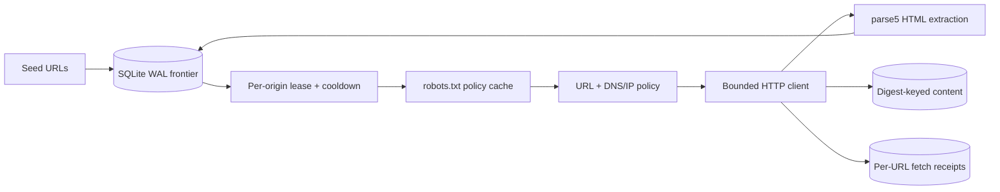

# System Design 09: Web Crawler

This repository is an executable, evidence-first crawler slice. It persists a canonical URL frontier in SQLite, acquires one expiring lease per origin, fetches and caches `robots.txt`, validates and pins DNS egress, follows only policy-safe redirects, stores bounded HTML bytes by SHA-256 digest, discovers links with a real HTML parser, and recrawls with HTTP validators.

The implementation is intentionally single-host. It proves local state and network-policy behavior; it is not a search engine, distributed crawler, public crawling authorization, or production-capacity result.

## The behavior contract

1. A seed becomes one canonical fragment-free HTTP(S) URL.
2. The frontier can lease at most one URL for an origin. A second URL waits until the active token is released and the origin cooldown expires.
3. A crashed worker leaves a lease. After its deadline, a later scheduler clears exactly that token, applies a crash cooldown, and increments the URL attempt on the next lease.
4. Before a page request, the crawler obtains the applicable robots policy. Fresh cached rules are reused for at most 24 hours.
5. DNS answers are parsed as IP addresses. Outside an explicit test fixture, every answer must be public unicast; the selected approved address is passed into the socket lookup.
6. Cross-origin redirects become new frontier entries. They are not followed inside the old origin lease. Same-origin redirects are bounded, delayed, and revalidated.
7. Only identity-encoded `text/html` bodies up to 2 MiB are stored. Discovered links are canonicalized and bounded by depth and per-page count.
8. Equal SHA-256 bytes share one content object, while each URL, HTTP result, validator, attempt, and fetch receipt stays distinct.

## Requirements and arithmetic

The learning workload adopts an explicit scenario rather than claiming observed traffic:

| Input | Assumption | Derived value |
|---|---:|---:|
| Pages | 1 billion/month | about 386 pages/s over 30 days |
| Planning peak | 2x average | about 772 pages/s, rounded to 800 |
| Average stored HTML | 500 KiB | about 512 TB/month decimal |
| Retention | 5 years | about 30.7 PB raw before deduplication |

At 800 pages/s and 500 KiB/page, response bodies alone are about 410 MB/s before headers, retries, robots, redirects, replication, indexes, compression, parsing, and extracted data. If the average is 1 MiB instead, five-year raw storage is about 62.9 PB. The input size, not a memorized “30 PB,” must drive the choice.

This repository caps each HTML body at 2 MiB and runs a loopback fixture. It does not benchmark those scenario numbers.

## Minimal architecture



The key scheduler state is not a FIFO alone. `origins.active_lease_token` prevents overlap; `next_allowed_at_ms` enforces completion-to-next-request cooldown and origin-wide `Retry-After`/backoff. Priority only chooses among eligible origins and never overrides politeness.

## Standards-driven corrections

- [RFC 9309](https://www.rfc-editor.org/rfc/rfc9309.html) requires a crawler to follow parseable rules after a successful robots fetch. A 4xx makes the file unavailable and permits access; a 5xx or network failure makes it unreachable and requires complete disallow unless a cached copy is used. The RFC also says cached robots content normally should not be used for more than 24 hours.
- `Crawl-delay` is not part of RFC 9309. This slice uses a configured minimum cooldown and applies HTTP `Retry-After` to the whole origin.
- [RFC 9110 conditional requests](https://www.rfc-editor.org/rfc/rfc9110.html#name-conditional-requests) define `If-None-Match`, `If-Modified-Since`, and `304 Not Modified`. A 304 refreshes URL metadata without creating a content object.
- URL and HTML parsing use the [WHATWG URL](https://url.spec.whatwg.org/) and [HTML](https://html.spec.whatwg.org/) models through platform URL parsing and `parse5`; a regex is not treated as an HTML parser.
- A crawler makes requests to untrusted destinations, so it is an SSRF-capable component. The egress boundary follows the defense-in-depth concerns in the [OWASP SSRF guidance](https://cheatsheetseries.owasp.org/cheatsheets/Server_Side_Request_Forgery_Prevention_Cheat_Sheet.html): schemes are restricted, DNS answers are classified, redirects are not blindly followed, and the approved address is pinned into the request.

## Run locally

Node.js 22 or newer is required.

```sh
npm ci --ignore-scripts
npm run check
```

The full gate runs 21 deterministic tests, a real loopback HTTP/SQLite `SIGKILL` smoke, a bounded SQLite frontier benchmark, static checks, and dependency audit. Node 22 currently labels `node:sqlite` experimental; the Node 22/24/26 CI matrix is the compatibility receipt, not a promise about future APIs.

The CLI refuses local/private network destinations by default:

```sh
node src/main.js seed https://example.com/
node src/main.js run --max-jobs=10
node src/main.js stats
```

State defaults to `.tmp/crawler.sqlite`; override it with `CRAWLER_STATE_PATH`. The test-only local-origin exception requires both `NODE_ENV=test` and an exact `CRAWLER_ALLOWED_TEST_ORIGINS` JSON array. It exists for fixtures and is not a production allowlist mechanism.

## Repository map

- [Architecture, state machine, and failure windows](docs/architecture.md)
- [Crawler policy contract](docs/policy.md)
- [ADR: single-host durable frontier](docs/adr/0001-single-host-durable-frontier.md)
- [Threat model](docs/threat-model.md)
- [Operations](docs/operations.md)
- [Verification record](docs/verification.md)
- `src/frontier-store.js`: SQLite schema, leases, receipts, content identity, and recrawl state
- `src/http-fetcher.js`: bounded HTTP, DNS pin, redirects, timeout, and `Retry-After`
- `scripts/runtime-smoke.mjs`: lease, `SIGKILL`, recovery, real robots/page requests, content dedup, and 304

## Evidence boundary

Passing the gates supports only the tested canonicalization, local leases, origin cooldown, robots decisions, egress checks, bounded fetches, HTML extraction, raw-byte deduplication, conditional recrawl, and process-crash recovery. It does not prove full RFC conformance of the parser dependency, compressed/body-encoding handling, JavaScript rendering, sitemap support, `X-Robots-Tag`, content quality, canonical-page semantics, distributed frontier coordination, public-web politeness, legal permission, database power-loss durability, production scale, deployment, SLA, or external acceptance.

The problem taxonomy was prompted by a fixed snapshot of `liquidslr/system-design-notes`. That tree had no detected license, so this repository copies no prose, diagrams, or code from it. The implementation and documentation were independently derived from the standards above.

## License

[MIT](LICENSE)
